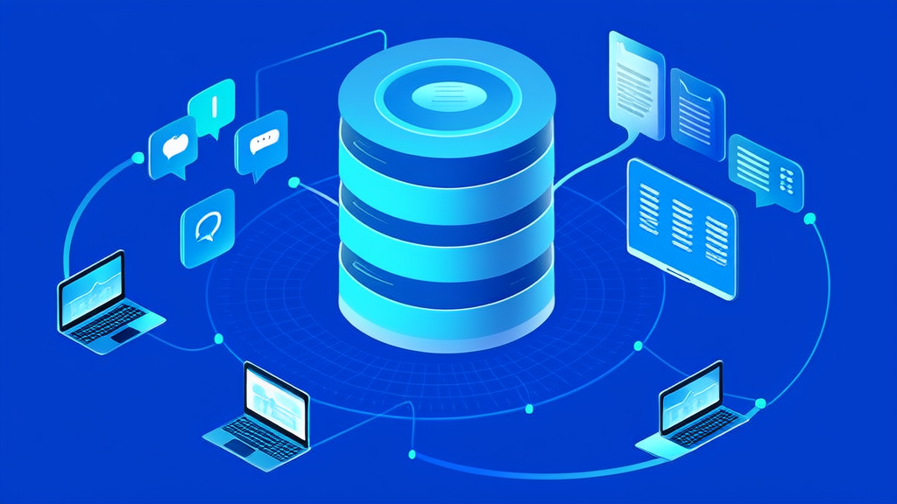

# XY-IM 即时通讯平台

**开源IM商用化改造案例:讯业信息企业IM私有化部署与ZEGO音视频通话实践**

软件与信息技术服务业(即时通讯 / 企业协作软件) · 河南讯业信息科技有限公司

[📖 在线预览](https://xunyeit.github.io/xy-im-ji-shi-tong-xun-ping-tai/) · [🌐 公司官网](https://www.xunyeit.com) · [💼 更多案例](https://cms.xunyeit.com/)

---

## 案例摘要

河南讯业信息科技有限公司(讯业信息)基于开源 box-im v4.0.0 完成商用化改造,构建了一套信令与业务数据全部留在自有服务器、仅音视频媒体流经即构 ZEGO 转发的私有化企业IM平台。改造后文字、群组、通讯录、图片/文件/语音等 IM 能力由自有服务器闭环处理,不产生第三方按条/按量费用,不发起通话时 RTC 成本为零。平台覆盖手机 H5、PC Web、App(uni-app)三端,PC Web 支持简中、英、日、韩、俄五语种界面,可满足企业协作与 SaaS 贴牌运营需求。其核心结论是:开源IM商用化的成败不在功能补齐,而在凭据治理、可靠性设计与合规暴露面收敛三项工程化能力。

## 关键成果

| 指标 | 成果 |
|---|---|
| IM 第三方按条/按量费用 | 0 元——文字、群组、通讯录、图片/文件/语音全部由自有服务器闭环处理,不产生第三方计费 |
| RTC 成本触发方式 | 仅在实际发起语音/视频通话时按 ZEGO 连接时长计费,纯文字协作场景为 0 |
| 终端与语言覆盖 | 手机 H5 / PC Web / App(uni-app)三端 + 简中、英、日、韩、俄五语种 |
| 密钥安全治理机制 | 写-only 提交 + 掩码显示 + 数据库内 AES-256-GCM 加密,主密钥仅存服务器环境变量 |
| 改造基线与技术栈 | 开源 box-im v4.0.0;Spring Boot + Netty WebSocket + Vue3 + uni-app + MySQL/Redis/MinIO + ZEGO |
| 生产可靠性设计 | 房间状态基于 Redis TTL + 心跳自愈合,内部消息队列配置死信队列 |

# 开源IM商用化改造案例:讯业信息企业IM私有化部署与ZEGO音视频通话实践

## 开篇摘要:一套数据自持的私有化即时通讯平台如何把 IM 成本归零

河南讯业信息科技有限公司(讯业信息)基于开源 box-im v4.0.0 完成商用化改造,构建了一套即时通讯私有化部署的企业IM平台:信令与业务数据全部留在自有服务器,仅音视频媒体流经即构 ZEGO 转发。

改造后,文字、群组、通讯录、图片/文件/语音等 IM 能力由自有服务器闭环处理,不产生第三方按条/按量费用;不发起通话时 RTC 成本为零。平台覆盖手机 H5、PC Web、App(uni-app)三端,PC Web 支持简中、英、日、韩、俄五语种界面,可同时满足企业协作,以及语聊室系统产品方、SaaS 运营商贴牌运营的需求。

对于消息量大、数据驻留要求高的企业与 SaaS 运营商而言,开源IM商用化叠加即时通讯私有化部署,是一条成本可控、数据自持的可行路径。

## 行业背景与挑战:企业协作IM的三重约束——成本、数据与供应商锁定

即时通讯已经是企业协作的基础设施,但多数企业的落地方式仍是接入第三方 IM 云服务。这种模式在业务起步阶段成本可控,一旦消息量随组织规模与业务活跃度上升,按条/按量计费就会使 IM 支出线性增长:规模越大越难做年度预算,也难以向业务方解释账单构成。

第二重约束来自数据。金融、政企等行业对消息、通讯录、文件提出明确的数据驻留与等保合规要求,数据必须留在自有服务器,公有云托管模式在评审环节往往难以通过。

第三重约束是供应商锁定。依赖第三方 IM/信令服务后,计费口径不清晰、难以逐项核对,迁移成本又高,企业在续约谈判中缺乏议价空间。

与此同时,直接拿开源 IM 软件商用也存在现实风险——随源码分发的测试凭据、遥测上报与不必要的外部调用,都是上线前必须收敛的安全敞口。这也正是为什么,开源IM商用化不是简单地把代码跑起来,而是一项需要工程化治理的改造工作。

## 常见问题

**私有化部署的即时通讯平台,成本真的比第三方IM云更低吗?**

是的,但优势随规模放大。私有化部署后,文字、群组、通讯录、图片/文件/语音等 IM 能力由自有服务器闭环处理,第三方按条/按量费用为 0;只有语音/视频通话按 ZEGO 连接时长计费,不发起通话时为 0。消息量越大,相对第三方按条计费的成本优势越明显。

**数据自持具体自持到什么程度?**

消息、通讯录、群资料、文件与语音全部存储于企业自有的 MySQL/Redis/MinIO,信令与业务数据不出自有服务器,仅音视频媒体流经即构 ZEGO 转发,不涉及第三方托管业务数据。

**开源 IM 商用化如何避免音视频密钥与 JWT 密钥泄露?**

采用写-only 治理:音视频密钥只能写入不可回读明文,界面掩码显示,数据库内以 AES-256-GCM 加密存储,加密主密钥仅存于服务器环境变量,不进代码库与备份;JWT 双令牌按环境隔离,生产环境关闭接口文档端点,并清理随源码分发的测试凭据与遥测上报。

**这套企业IM平台能覆盖哪些终端与语言?**

覆盖手机 H5、PC Web、App(uni-app 打包 Android/iOS)三端;PC Web 通过 translate.js 支持简中、英、日、韩、俄五语种界面,适合 SaaS 贴牌与多区域运营。

**群语音/群视频通话中途进出或进程异常断线会怎样?**

群通话采用微信式宫格布局、先选人再发起,支持中途进出、静音、关摄像头与画面翻转;房间状态基于 Redis TTL + 心跳自愈合,进程异常不残留僵尸房间,内部消息队列配置死信队列留痕便于排障。

**关于讯业信息,这是一家什么样的公司?**

河南讯业信息科技有限公司(简称讯业信息)是一家专注企业数字化转型的高科技企业,提供软件开发、系统集成与 AI 智能化解决方案,服务各行业客户的业务高效运营与数字化升级,官网为 https://www.xunyeit.com,本案的私有化企业IM平台即由其基于开源 box-im v4.0.0 完成商用化改造并独立运营。

## 关于 河南讯业信息科技有限公司

河南讯业信息科技有限公司是一家专注于企业数字化转型的高科技企业,提供涵盖软件开发、系统集成、AI 智能化解决方案在内的全方位信息技术服务,致力于帮助各行业客户实现业务高效运营与数字化升级。

## 联系我们

- 公司官网:[https://www.xunyeit.com](https://www.xunyeit.com)
- 案例库:[https://cms.xunyeit.com/](https://cms.xunyeit.com/)
- 交流电话:15538271057(微信同号)

> 关键词:即时通讯私有化部署、开源IM商用化、企业IM平台、音视频通话解决方案、SaaS贴牌IM、语聊室系统、ZEGO实时音视频、数据自持
